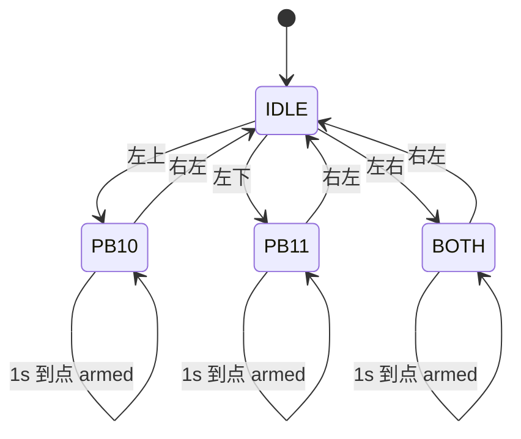

## Product Overview
把 BR 下位机中龙门（Gantry）机构的占位控制逻辑改造成由遥控器按键驱动的三态状态机：进入状态后立即锁定 PB10/PB11 电平，1 秒后开始持续下发电机指令，释放键把两脚拉低并回到初始态。改造后机构能按三个固定方向到位并保持，直到人工释放。

## Core Features
- 三个工作状态：
  - 状态一：PB10 置高，PB11 保持低；
  - 状态二：PB11 置高，PB10 保持低；
  - 状态三：PB10、PB11 同时置高。
- 电平锁存：进入状态后两脚一直保持该组合，不再像现在这样每 2 ms 做一次 SET+RESET 脉冲。
- 1 秒门控：进入状态时开始计时，满 1 秒后才开始周期性下发电机指令；1 秒内不发。
- 持续输出：到点后每 2 ms 持续下发，机构到位后停在该位置；当前目标电流为 0，电机本身不动，只为后续接入预留时序。
- 释放：释放键把 PB10、PB11 同时拉低，停止下发并回到初始态；释放后再按任一状态键可重新进入。
- 按键映射：左上=状态一，左下=状态二，左右=状态三，右左=释放。
- 切换规则：非初始态下忽略其余状态键，必须先释放；初始态下忽略释放键。
- 状态、计时、使能标志可在线观察，便于台架调试。


## 技术栈
- STM32F407 + STM32 HAL + FreeRTOS，Keil MDK（ARMCC V5），沿用现有工程
- 不新增源文件，`BR.uvprojx` 不需要改动

## 现状与目标
`Gantry_Task()` 当前每 2 ms 依次执行：两次 `PID_Control2(0,0,...)`、`MotorSend(&hcan1, 0x1FF, motorCurrentBuf)`、然后对 PB10/PB11 各做一次 SET+RESET 的瞬时脉冲，无任何状态记忆。改造后保留“每 2 ms 一次”的节拍，把脉冲改为锁存，并按状态门控电机下发。

## 实现思路

### 1. 状态与对外可见量（`MyTask/Gantry.h`）
新增状态枚举与三个 `volatile` 变量（Keil Watch 可直接看）：
- `GantryState_t`：IDLE / PB10 / PB11 / BOTH
- `g_gantry_state`、`g_gantry_armed`（1 秒到点标志）、`g_gantry_ms_in_state`（进入后经过的毫秒数）
- `GANTRY_ARM_DELAY_MS`（1000）与 `GANTRY_CMD_CURRENT`（0.0f，后续接真实目标值只改这一处）

### 2. 按键读取与边沿检测（`Gantry.c`）
- `Remote_Control.First` 由 10 ms 周期的 `Remote_Analysis()` 刷新，而 `Gantry_Task` 是 2 ms；因此**不能**用 `Remote_Control.Second` 做上一拍，否则每个遥控帧会被判成多次上升沿。
- 在 `Gantry_Task` 内部保留一份本地快照 `s_prev_keys`，每 2 ms 更新一次，用现有 `KEY_RISING_EDGE(cur, last, field)` 宏判边沿。
- 读取 `Remote_Control.First` 时用 `taskENTER_CRITICAL()` 整体拷贝一份（14 字节结构体拷贝非原子，避免撕裂读产生虚假边沿）。
- 需在 `Gantry.c` 中 `#include "Task_Init.h"` 以获得 `hw_key_t` 与 `Remote_Control` 声明（该头文件不引用 `Gantry.h`，无循环包含）。

### 3. 状态机主体（`Gantry.c` 的 `Gantry_Task`）
- 仅在 `IDLE` 下响应三个状态键的上升沿；进入时：写引脚、记录 `t_enter`、`g_gantry_armed = 0`、复位两个 PID、清 `s_motor_stopped`。
- 非 `IDLE` 下只响应释放键上升沿：两脚拉低、`g_gantry_armed = 0`、复位 PID、**先补发一帧 0 电流**再停止下发（避免电调停在上一帧指令）、回 `IDLE`。
- 非 `IDLE` 下其它状态键的上升沿直接忽略（满足“必须先释放”）。
- 每个循环更新 `g_gantry_ms_in_state = now - t_enter`；`state != IDLE && !armed && elapsed >= GANTRY_ARM_DELAY_MS` 时置 `armed = 1`。全部用 `xTaskGetTickCount()` 比较，不阻塞任务，保持 2 ms 节拍。
- 收尾必须 `s_prev_keys = 本次快照`，再 `vTaskDelayUntil`。

### 4. 引脚写入改为单次原子写
三态切换时两脚可能同时变化（进/出状态三），连续两次 `HAL_GPIO_WritePin` 会出现一个中间组合（例如先拉低 PB10 再拉低 PB11）。改为一次 BSRR 写：
```c
GPIOB->BSRR = (pb10 ? GPIO_PIN_10 : (GPIO_PIN_10 << 16)) |
              (pb11 ? GPIO_PIN_11 : (GPIO_PIN_11 << 16));
```
`gpio.c` 中 PB10/PB11 已是 `GPIO_MODE_OUTPUT_PP` + 下拉、初始 ODR 为 0，无需改初始化。

### 5. 电机下发门控
- `IDLE` 与 1 秒窗口内：不发帧（严格符合“1 秒后再 motorsend”）。当前目标为 0，C620 会保持上一帧的 0 电流，无风险。
- `armed == 1` 后：每 2 ms 执行原有 `PID_Control2` 两次 + `MotorSend(&hcan1, 0x1FF, motorCurrentBuf)`，`motorCurrentBuf[0]` 取 `GANTRY_CMD_CURRENT` 相关通路，默认仍为 0。
- 已核对：`0x1FF` 的第 0 字节对应电调 ID `0x205`，与 `g_gantry_3508.ID = 0x205` 一致，**该 CAN ID 不要改**。

### 6. PID 复位
进入与释放时把 `pos_pid` / `vel_pid` 的 `error_now`、`error_last`、`error_inter`、`pid_out` 清零。当前增益全为 0，输出不受影响；这是为以后填增益后避免跨状态积分残留打机构。

### 7. 任务栈
`Task_Init.c` 中 `Gantry_Task` 栈为 128 words（512 B）。加入状态机与结构体拷贝后建议提到 256 words，属一行改动、无副作用。

## 约束与风险
- `Left_Key_Left` 已被 `Chassis_ToggleCtrlSrc()`（遥控/上位机切换）占用，本状态机不使用它。
- 遥控链路断开时 `Remote_Control.First` 不再更新，读到的按键保持最后一次值且不产生新边沿，状态会**保持**在当前位置（不会自动释放）。这是刻意行为，现场需知道。
- 不新增代码注释（沿用当前偏好），仅靠宏与枚举命名自解释。
- 不改动 `Remote_Analysis()`、`Chassis_Task`、串口/USB 任何逻辑。

## 状态流转


## 目录结构
```
BR/
├── MyTask/
│   ├── Gantry.h   # [MODIFY] 增加 GantryState_t 枚举、状态/计时/使能 extern、GANTRY_ARM_DELAY_MS 与 GANTRY_CMD_CURRENT 宏；保留原有 Gantry_Task 与 g_gantry_3508 声明
│   ├── Gantry.c   # [MODIFY] 重写 Gantry_Task：临界区按键快照、上升沿检测、三态状态机、引脚 BSRR 原子写入、PID 复位、1 秒计时、按 armed 门控 MotorSend；删除原 SET+RESET 脉冲
│   └── Task_Init.c# [MODIFY] 仅把 Gantry_Task 的栈参数 128 改为 256
```

