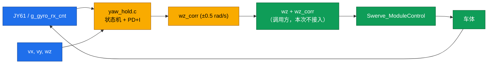

## 产品概述
为四舵轮底盘新增一个独立的**陀螺仪航向修正库**，文件放在 `MyTask/` 下，本次只交付 `.c/.h` 与工程配置，**不接入** `Chassis_Task`，供后续学习与验证后启用。

## 核心功能
- 输入车体速度指令 `vx / vy / wz`（前正、左正、逆时针正）与周期 `dt`，输出一个可叠加到 `wz` 上的修正量 `wz_corr`（rad/s）。
- 采用航向 PD + 角速度阻尼：`wz_corr = Kp·e + Ki·∫e − Kd·gyro_z`，其中 `e = wrap180(yaw_ref − yaw)`，Kd 项直接取陀螺角速度。
- **直行锁存**：仅当车在动且操作员未主动转向时闭环，参考航向锁存于进入直行的瞬间；转向中、停车时输出 0 并清积分。
- 内置状态机：`WAIT_IMU / STRAIGHT / TURNING / FAULT`，IMU 数据超时自动进入 FAULT 并停止干预。
- 安全限幅与抗饱和：输出限幅、积分输出限幅、积分分离、IMU 掉线保护。
- 提供一键关闭宏 `YAW_HOLD_EN`，置 0 时接口恒返回 0，行为完全退回现状。
- 提供在线可观测的调试量（修正量、航向误差、参考航向、当前状态、故障计数），便于 Watch 观察而不改控制逻辑。
- 头文件内附 `Chassis_Task` 的三行接入示例（注释形式），说明将来如何启用。

## 视觉/交互效果
无界面。功能效果为：启用后直行时可抑制左右轮速不等造成的持续偏航（画弧），转弯与停车时完全不干预操控。


## 技术栈
沿用现有工程，无新增依赖：
- 语言/编译器：C（ARMCC V5.06，C90 风格，变量声明必须位于块首）
- 平台：STM32F407 + HAL
- 已就绪的上游数据：`MyLib/JY61.h`（`JY61.Angle.Multiturn`、`JY61.AngularVelocity.Z`、`g_gyro_rx_cnt`）
- 工程管理：Keil `MDK-ARM/BR.uvprojx`（`MyTask` 分组，`IncludePath` 已含 `..\MyTask;..\MyLib`）

## 实现方案

### 总体策略
新建独立的**无状态外部依赖的静态状态库**：所有运行状态放在 `yaw_hold.c` 的 `static` 变量中，对外只暴露 `Init/Reset/Update/GetState`。`dt` 由调用方传入（2 ms 固定值），库内部不创建任务、不加锁、不动态分配，因此可被任意任务安全周期调用。库只读 `JY61` 与 `g_gyro_rx_cnt`，只依赖 `HAL_GetTick()` 做 IMU 判活（工程里 TIM1 已提供 1 ms tick），不依赖 FreeRTOS API。

### 关键设计决策
1. **用航向角环而非纯角速度环**：纯角速度环在陀螺零偏下仍有恒定偏航速率，无法消除画弧；航向角环对零偏不敏感，稳态无差。
2. **Kd 项用陀螺角速度而非误差微分**：航向角由 IMU 以 10~100 Hz 阶梯式更新，对误差微分会把阶梯放大成电流毛刺；陀螺角速度连续，天然适合做阻尼。
3. **直行锁存而非全程闭环**：用户当前只要求"走直"，全程闭环会改变转向手感并引入 IMU 跳变甩车风险。锁存方案对操控零侵入，且容易分阶段验证。
4. **不使用现成第三方库**：GitHub 上同类实现为 FRC 的 Java（YAGSL `setHeadingCorrection`、WPILib `SwerveDrivePoseEstimator`），无 C 可移植版本；逻辑本体只有数十行，自实现的收益高于移植成本。
5. **符号可配**：`YAW_SIGN` / `GYRO_SIGN` 两个 ±1 宏，实测后一行翻转，避免反复改算法。
6. **纯 static 不加互斥**：库只在 `Chassis_Task`（2 ms、单任务）中被调用；若将来多任务调用，由调用方串行化，避免无谓的临界区开销。

### 状态机与时序
- `WAIT_IMU`：上电初始态。`g_gyro_rx_cnt` 累计变化达 3 次才离开，期间输出 0、`yaw_ref` 持续对齐当前航向。
- `FAULT`：`g_gyro_rx_cnt` 在 `YAW_HOLD_IMU_TIMEOUT_MS`(100 ms) 内无变化 → 输出 0、清积分、`g_yaw_fault_cnt++`；数据恢复后回到 `WAIT_IMU`（重新累计 3 次）以防抖动误入闭环。
- `TURNING`：`|wz| >= YAW_HOLD_WZ_TURN_DEAD`(0.15 rad/s) → 输出 0、清积分、`yaw_ref` 跟随当前航向（保证退出转向后立刻锁在正确方向）。
- `STRAIGHT`：`|wz| < 0.15` 且 `|vx|+|vy| > YAW_HOLD_VEL_DEAD`(0.05 m/s) 连续满足 `YAW_HOLD_ENTER_MS`(100 ms) → 锁存 `yaw_ref`，进入闭环。进入去抖用于滤掉摇杆中位噪声造成的状态抖动。

### 控制参数（初值，可在线调）
| 参数 | 值 | 含义 |
|---|---|---|
| `Kp` | 2.0 | rad/s per rad，1° 误差约产生 0.035 rad/s |
| `Ki` | 0.4 | 1/s² |
| `Kd` | 0.05 | rad/s per rad/s（乘陀螺角速度） |
| 积分分离阈值 | 5° | 误差大于该值不积分，防入场积分打满 |
| 积分输出限幅 | ±0.2 rad/s | 抗饱和 |
| 输出限幅 | ±0.5 rad/s | 约 28 °/s，远大于典型漂移，又不至于甩车 |

带宽校核：内环（舵轮对 `wz` 的响应）约 2~5 Hz，航向环穿越频率约 0.3 Hz，安全。

### 性能与实时性
每周期仅约 20 次浮点运算与 1 次 `HAL_GetTick()` 读取，耗时 <5 µs，占 2 ms 周期不到 0.3%，无除法以外的昂贵运算（`wrap180` 用加减循环，最多 1~2 次迭代）。

### 与现有代码的边界（本次不改）
- 不改 `MyLib/swerve.c`（逆解）
- 不改 `MyTask/app.c` 的 `Chassis_Task` / `is_turn_down()`
- 不改 `MyTask/Task_Init.c`
- 不改 `MyTask/config.h`
- 唯一改动的现有文件：`MDK-ARM/BR.uvprojx`（加入两个文件条目，否则不参与编译无法验证）

### 已知待处理项（写入头文件注释，供启用时决策）
`is_turn_down()` 在任意一轮转向误差 > `steer_deadband`(3°) 时清零四轮驱动，是航向环的干扰源。启用本库时需同步处理（逐轮门控 / 加宏临时关闭 / 收 deadband 并给转向环加积分），本次不实现。

## 架构设计
数据流为单向：`JY61`（只读）+ 速度指令 → `YawHold_Update()` → `wz_corr` → 由调用方叠加到 `wz` 后送入 `Swerve_ModuleControl()`。



## 目录结构
概要：新增 `MyTask/yaw_hold.h` 与 `MyTask/yaw_hold.c`，并在 Keil 工程的 `MyTask` 分组登记；其余文件零改动。

```
BR/BR/
├── MyTask/
│   ├── yaw_hold.h        # [NEW] 航向修正库头文件。定义开关宏（YAW_HOLD_EN）、符号宏（YAW_SIGN/GYRO_SIGN）、
│   │                     #       时间与门限宏（IMU_TIMEOUT_MS、WZ_TURN_DEAD、VEL_DEAD、ENTER_MS）、
│   │                     #       参数宏（KP/KI/KD/积分分离/限幅）、YawHoldState_t 枚举、
│   │                     #       Init/Reset/Update/GetState/GetStateName 声明、调试量 extern 声明，
│   │                     #       以及 Chassis_Task 的三行接入示例（注释形式，含 is_turn_down 注意事项）。
│   └── yaw_hold.c        # [NEW] 航向修正库实现。含 wrap180、锁存与去抖计时、四态状态机、
│   │                     #       PD+I 计算、积分分离与双重限幅、IMU 判活（HAL_GetTick + g_gyro_rx_cnt）、
│   │                     #       调试量写入。全部状态为 static；C90 风格，变量声明置于块首。
├── MDK-ARM/
│   └── BR.uvprojx        # [MODIFY] 在 GroupName=MyTask 的 <Files> 内追加两条 File 条目：
│                         #          yaw_hold.c（FileType 1, ..\MyTask\yaw_hold.c）
│                         #          yaw_hold.h（FileType 5, ..\MyTask\yaw_hold.h）
└── (未改动) MyLib/swerve.c、MyTask/app.c、MyTask/Task_Init.c、MyTask/config.h
```

## 关键代码结构
```c
/* MyTask/yaw_hold.h —— 对外接口 */
typedef enum
{
    YAW_STATE_WAIT_IMU = 0,   /* 等待 IMU 数据 */
    YAW_STATE_STRAIGHT,       /* 直行锁存，闭环输出 */
    YAW_STATE_TURNING,        /* 主动转向，不干预 */
    YAW_STATE_FAULT           /* IMU 掉线，不干预 */
} YawHoldState_t;

void           YawHold_Init(void);                       /* 上电初始化，清零状态与积分 */
void           YawHold_Reset(void);                      /* 运行时复位（切换控制源/急停恢复时用） */
float          YawHold_Update(float vx, float vy, float wz, float dt);  /* 返回 wz_corr (rad/s) */
YawHoldState_t YawHold_GetState(void);
const char    *YawHold_GetStateName(void);               /* 便于 Watch 直接看字符串 */

/* 调试量（Watch 可见，只写不改控制路径） */
extern volatile float    g_yaw_corr;      /* 本周期输出 rad/s */
extern volatile float    g_yaw_err_deg;   /* 航向误差 deg */
extern volatile float    g_yaw_ref_deg;   /* 参考航向 deg */
extern volatile uint8_t  g_yaw_state;     /* 同 YawHoldState_t */
extern volatile uint32_t g_yaw_fault_cnt; /* 进入 FAULT 的次数 */
```

调用方接入示例（仅写在头文件注释里，本次不落地）：
```c
/* Chassis_Task 内，Swerve_ModuleControl 之前：
   float wz_corr = YawHold_Update(vx, vy, wz, CHASSIS_TASK_PERIOD_MS * 0.001f);
   float wz_use  = wz + wz_corr;
   之后两处 wz 改为 wz_use（Swerve_ModuleControl 与 Chassis_OdomStep）。
   注意：启用前需先处理 is_turn_down() 清四轮驱动的问题。 */
```

